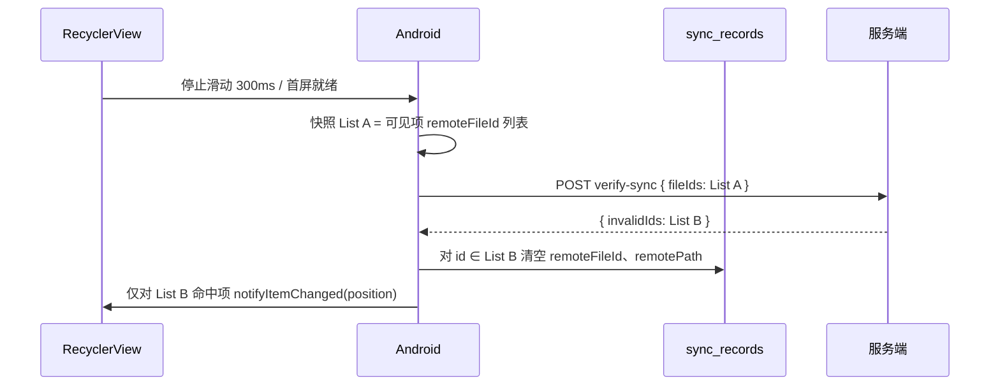

# 悠悠爸家庭云盘 · Android 手机 Tab 同步态校验 PRD

| 属性 | 内容 |
|------|------|
| 文档版本 | v1.1 |
| 状态 | **已实现（v1.1）** |
| 产品模块 | Android 客户端 · 相册 / 视频 / 音频 · **手机 Tab** |
| 关联文档 | `PRD-Android媒体列表手机云端分Tab-v1.md`、`产品说明-Android客户端-v1.md`、`SyncRecord.java` |
| 动机 | 去掉手机 Tab 对全量 `sync-index` / `cloud_index` 的依赖；用本地 `sync_records` + 按需服务端校验，解决「硬盘直删 / 幽灵记录仍显示已同步」与索引维护复杂问题 |

---

## 1. 需求背景

### 1.1 现状问题

| 问题 | 描述 |
|------|------|
| 索引过重 | 手机 Tab 打开时拉 `sync-index`、`reconcile`，维护 `cloud_index` 与 `sync_records` 交叉判定 |
| 误标已同步 | 服务端磁盘直删后，本地 `remotePath` 仍在、`cloud_index` 增量难感知删除 |
| 体验闪烁 | 异步校验后全量 `notifyDataSetChanged()` 导致列表闪白 |

### 1.2 核心诉求（一句话）

> **手机 Tab：本地相册直接展示；「已同步」只看本地 `remoteFileId`；对已同步项按需向服务端校验是否仍存在，失效则清空本地关联。云端 Tab：列表以服务端为准，下载态仅查本地。**

### 1.3 与前期 Hash 方案的关系

| 场景 | 方案 |
|------|------|
| **已有 `remoteFileId` 的记录** | 本 PRD：**按 ID 批量校验**（轻量、精准） |
| **从未上传、`remoteFileId` 为空** | 显示「未同步」；可选后续 PRD：`SHA-256` + `check-sync` 发现「其实已备份但未关联」 |

本期 **P0 只做 ID 校验**，不替换上传秒传 hash 逻辑。

---

## 2. 产品目标

### 2.1 目标

1. 手机 Tab 首屏 **本地 MediaStore 分页 50 条**，不依赖 `sync-index` 出列表。
2. **已同步**展示规则：`sync_records.remoteFileId != null`（且本地文件仍可访问）。
3. 对已同步可见项 **异步批量校验**；服务端判定不存在 → 客户端 **清空 `remoteFileId`、`remotePath`**，角标回「未同步」。
4. 校验过程 **不引发列表全量刷新闪烁**。
5. 云端 Tab **不做**云端存在性联网校验；下载态仅 **本地** 查 `sync_records` + 文件是否在。

### 2.2 非目标（本期不做）

- 删除 `cloud_index` 全表（云端 Tab 改造可后续单独立项）
- 无 `remoteFileId` 项的 SHA-256 批量「发现已备份」（P1）
- Web / 启动器「媒体库对账」
- 服务端定时孤儿清理（P1，与本 PRD 互补）

---

## 3. 信息架构与状态定义

### 3.1 手机 Tab

| 状态 | 判定（展示层，同步） | 说明 |
|------|----------------------|------|
| **未同步** | `remoteFileId == null` | 含从未上传、校验失效后清空 |
| **已同步** | `remoteFileId != null` | 先本地展示；后台校验可降级为未同步 |
| **已分享** | 已同步 + 分享标记 | 角标，不改变主状态语义 |

**列表数据源**：MediaStore 分页（`localUri` 为行锚点）。  
**关联表**：`sync_records`（`localUri` ↔ `remoteFileId` / `remotePath`）。

### 3.2 云端 Tab

| 状态 | 判定 | 是否联网 |
|------|------|----------|
| **未下载** | 本地无有效 `sync_records` 或本地文件不存在 | 否 |
| **已下载** | `sync_records` 有映射且 `localUri` 对应文件可读 | 否 |

**列表数据源**：服务端分页接口（如 `album-photos` 或等价 list API）。  
**不做**：拿 `remoteFileId` 再向服务端问「还在不在」（列表已是服务端真值）。

### 3.3 云端有、本地无（双 Tab 分工）

| 场景 | 手机 Tab | 云端 Tab | sync_records |
|------|----------|----------|--------------|
| 从未在本机出现（他端上传 / Web / 磁盘导入） | **不展示** | 展示，**未下载** | 无记录；下载后新建 |
| 本机曾有、用户删了本地文件 | **不展示**（MediaStore 已无） | 展示，**未下载** | bind 时发现本地不可读 → 清空 `remoteFileId` / `remotePath`（P1 GC） |
| 用户从云端 Tab 下载成功 | 出现该项，**已同步** | **已下载** | upsert `localUri` + `remoteFileId` + `remotePath` |

**原则**：手机 Tab **不**为「仅云端」项插行；用户看云端独有内容 → **云端 Tab** → 预览 / 下载。  
**不**自动下载到本机（本期无「自动拉取云端到本地」）。

### 3.4 产品决策（已确认，2026-08-12）

| 决策项 | 结论 |
|--------|------|
| **无网络时 verify-sync** | **保持**「已同步」展示；**不清空** `remoteFileId` / `remotePath`（避免离线误降级） |
| **MediaStore 分页大小** | **50** 条/页（代码由现 48 调整为 50） |

---

## 4. 功能详述

### 4.1 手机 Tab · 列表加载

```
进入相册（默认手机 Tab）
  → MediaStore 分页 limit=50
  → LEFT JOIN sync_records（按 localUri）
  → 绑定 UI：remoteFileId 非空 → 已同步；否则 → 未同步
  → 不请求 sync-index / reconcile（本期移除手机 Tab 对二者的打开依赖）
```

### 4.2 手机 Tab · 同步态校验（核心）

**触发对象**：当前校验批次内，`remoteFileId IS NOT NULL` 的项（仅已同步候选）。

**触发时机**：

1. 首屏加载完成后（对首屏内已同步项）
2. 用户 **停止滑动 ≥ 300ms** 后，对 **当前可见范围** 内已同步项
3. 满足频控（见 §4.4）

**流程**：



**服务端判定「存在」须同时满足**：

- `files.id` 属于当前登录用户
- `deleted_at IS NULL`
- 磁盘文件仍存在（`isActiveFileOnDisk`）

不满足 → 归入 `invalidIds`。

**客户端失效处理**：

- `UPDATE sync_records SET remoteFileId=NULL, remotePath=NULL WHERE remoteFileId IN (List B)`
- **不清除** `localUri`、`fileHash` 等本机字段
- UI：绿勾（已同步）→ 上传箭头（未同步）

### 4.3 UI 刷新 · 防闪烁（必做）

| 做法 | 评价 |
|------|------|
| 校验返回后 `notifyDataSetChanged()` | ❌ 禁止：全列表闪白 |
| 校验返回后仅对失效项 `notifyItemChanged(position)` | ✅ 必须 |

**正确实现要点**：

1. **发起请求前**：截取当前批次 `remoteFileId` 快照 **List A**（与当时可见 position 映射表）。
2. **收到响应 List B（invalidIds）后**：写 DB。
3. **UI 更新**：只遍历 **当前 RecyclerView 已 attach 的 ViewHolder**，若该 position 的 `remoteFileId ∈ List B`，才 `notifyItemChanged(position)`。
4. **未滚到的项**：下次 `onBindViewHolder` 读 DB 自然是最新态，无需提前刷新。

> 注：用户原文「浅拷贝对比」在此指 **快照 List A 与响应 List B 的集合对比 + 局部 notify**，非深拷贝对象。

### 4.4 触发时机（必做）

| 场景 | 是否调用 verify-sync |
|------|----------------------|
| **进入相册 / 首屏加载完成** | ✅ 对第一页已加载项中 `remoteFileId != null` 的批量校验 |
| **下拉刷新（手机 Tab）** | ✅ 重载第一页后同样校验 |
| **滚动 / 加载更多** | ❌ 不调用 |
| **无网络** | ❌ 不调用；保持「已同步」展示 |

首屏流程：MediaStore 第一页渲染完成 → 立即 `POST verify-sync` → 仅对失效项局部 `notifyItemChanged`。

### 4.5 云端 Tab · 下载态（本地 only）

```
服务端分页返回云端项（含 id / relativePath）
  → 内存查 sync_records：remoteFileId 或 remotePath 是否指向本地可读文件
  → 显示 未下载 / 已下载
  → 不发起 verify-sync
```

---

## 5. 服务端接口（P0 新增）

### 5.1 `POST /api/files/verify-sync`

**用途**：批量校验云端文件记录是否仍有效（库 + 盘）。

**请求**：

```json
{
  "fileIds": [ 1001, 1002, 1003 ]
}
```

| 字段 | 约束 |
|------|------|
| `fileIds` | 必填；1～100 个；须为 Long |

**响应**：

```json
{
  "invalidIds": [ 1002 ],
  "validIds": [ 1001, 1003 ]
}
```

| 字段 | 含义 |
|------|------|
| `invalidIds` | 不存在 / 已软删 / 磁盘无文件 |
| `validIds` | 仍有效（可选返回，便于日志） |

**错误**：

- 非本用户 id：视为 `invalidIds`（不泄露他人文件是否存在）
- 空数组：200 + 空列表

### 5.2 上传完成响应补充（P0 依赖）

上传 / 秒传成功响应须稳定返回 **`fileId`**（即 `files.id`），客户端写入 `sync_records.remoteFileId`。  
若当前 API 仅返回 `relativePath`，需 **P0 补齐 `fileId`**。

---

## 6. 客户端改造范围

### 6.1 手机 Tab 删除 / 弱化

| 现逻辑 | 动作 |
|--------|------|
| 打开相册 `ServerSyncCache.warmUp` / `sync-index` | 手机 Tab **移除** |
| `POST /reconcile` on 手机 Tab 首屏 | **移除** |
| `isSyncedFast(serverPaths)` | 改为 **`remoteFileId != null`** |
| 全量 `cloud_index` 判同步 | 手机 Tab **不再使用** |

### 6.2 新增模块（建议）

| 模块 | 职责 |
|------|------|
| `SyncVerifyScheduler` | 防抖、频控、窗口 in-flight |
| `SyncVerifyRepository` | 调 API、更新 DB、返回 invalidIds + position 映射 |
| `MediaTabFragment` | 滚动监听、触发校验、局部 notify |

### 6.3 分页大小

| 项 | 值 |
|----|-----|
| MediaStore 页大小 | **50**（**已确认**；实现时由现 48 改为 50） |

---

## 7. 用户故事与验收标准

### US-1 首屏展示

**作为**用户，**当我**打开相册手机 Tab，**我希望**立刻看到本机最近 50 张照片及同步角标，**而不等待**云端全量索引。

**验收**：

- [ ] 首屏 **≤1s** 出现本地缩略图（有权限、非冷启动极端情况）
- [ ] 首屏 **不调用** `GET /api/files/sync-index`
- [ ] `remoteFileId` 非空项显示「已同步」

### US-2 服务端删文件后纠正

**作为**在服务端硬盘直删照片的用户，**当我**回到手机 Tab 浏览，**我希望**Former 已同步项变为未同步。

**验收**：

- [ ] 服务端删磁盘文件后，下次校验（首屏或停滑 300ms 内）**≤10s** 角标变未同步（含网络正常）
- [ ] `sync_records` 中对应行 `remoteFileId`、`remotePath` 为 null
- [ ] 本地 MediaStore 照片 **仍在**，未被误删

### US-3 滑动不闪屏

**作为**用户，**当我**快速滑动相册，**我不希望**列表闪白或整页重载。

**验收**：

- [ ] 校验前后对比录屏：可见格 **无整页闪白**
- [ ] 日志/调试：校验返回后 **`notifyDataSetChanged` 调用次数 = 0**
- [ ] 仅失效项出现 `notifyItemChanged`

### US-4 防抖与频控

**作为**用户，**当我**快速上下滑动，**不应**产生请求风暴。

**验收**：

- [ ] 连续 fling 10 次，**verify-sync 请求 ≤ 窗口数 + 1**
- [ ] 同一 50 条窗口 10 分钟内 **最多 1 次** verify-sync
- [ ] 停滑后 **≥300ms** 才发请求

### US-5 云端 Tab 不受影响

**验收**：

- [ ] 云端 Tab 列表来自服务端分页，**不调用** verify-sync
- [ ] 下载态仅本地查表，**无额外联网**

### US-6 仅云端项只在云端 Tab 展示

**验收**：

- [ ] 仅存在于云端的照片/视频 **只出现在云端 Tab**，手机 Tab **不得**出现
- [ ] 云端 Tab 显示 **未下载**；下载成功后变 **已下载**

### US-7 本地删除后云端仍可再下

**验收**：

- [ ] 用户删除本机文件后，手机 Tab 该项消失；云端 Tab 仍为 **未下载**
- [ ] 无效 `sync_records` 映射被清理，云端 Tab 不误显示 **已下载**

### US-8 云端下载后双 Tab 联动

**验收**：

- [ ] 从云端 Tab 下载成功后，手机 Tab 出现对应项且 **已同步**（`remoteFileId` 有值）

### US-9 离线不误降级

**验收**：

- [ ] 飞行模式下打开手机 Tab，原「已同步」项 **仍显示已同步**
- [ ] 恢复联网并触发校验后，才对失效项降级为未同步

---

## 8. 边界与异常

| 场景 | 行为 |
|------|------|
| 无网络 | **已确认**：保持 `remoteFileId` 展示已同步；**不**清空、**不**发起 verify-sync（恢复联网后再校验） |
| 校验 401 / 登出 | 中止校验，不清数据 |
| 校验 5xx / 超时 | 不清数据；窗口不计入「已校验」（可重试） |
| `remoteFileId` 有值但本地文件已被用户删 | 列表可不展示或展示失效；`sync_records` 可 GC（P1） |
| 上传成功但未写入 `remoteFileId` | 视为 P0 缺陷；上传链路必须补齐 |

---

## 9. 优先级

| 优先级 | 内容 |
|--------|------|
| **P0** | verify-sync API + 上传返回 fileId |
| **P0** | 手机 Tab 展示规则 + 校验 + 局部刷新 + 防抖频控 |
| **P0** | 移除手机 Tab 对 sync-index/reconcile 的打开依赖 |
| **P1** | 无 remoteFileId 的 SHA-256 check-sync（发现已备份） |
| **P1** | 服务端定时孤儿清理 |
| **P2** | 云端 Tab 完全去掉 cloud_index，改直连分页 API |

---

## 10. 开发任务拆分（附录）

| 端 | 任务 |
|----|------|
| **服务端** | `FileController.verifySync`；校验 userId + deleted_at + 磁盘；返回 invalidIds |
| **服务端** | 上传 complete 响应带 `fileId` |
| **Android** | 分页 50；bind 态读 `remoteFileId` |
| **Android** | `SyncVerifyScheduler`（300ms debounce、10min 窗口） |
| **Android** | 校验后 DB 更新 + 按 position 局部 notify |
| **Android** | 手机 Tab 移除 sync-index/reconcile 触发 |
| **测试** | US-1～US-9 手工 + 单元测试（Scheduler 频控） |

---

## 11. 修订记录

| 版本 | 日期 | 说明 |
|------|------|------|
| v1.1 | 2026-08-12 | 评审通过：无网不清空、分页 50；补充 §3.3 云端有本地无、US-6～US-9 |
| v1.0 | 2026-08-12 | 初稿：remoteFileId 校验、防闪烁、防抖频控、双 Tab 分工 |
